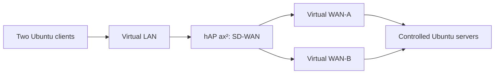

# Physical ARM64 lab with a single cable

[Русский](HARDWARE-LAB.md) | English

This setup uses a dedicated hAP ax² and remote Ubuntu. Two clients with distinct
IP/MAC addresses and two software providers run in Linux namespaces. The
controller runs on the physical MikroTik: RSC or a local unprivileged
Rust/scratch container. A service x86 L6 handles transport and L2 bridges only;
its disk is a COW copy of the licensed parent.



Three EoIP circuits run inside one SSTP session with certificate verification.
The sole Ethernet cable stays connected to the switch; the test LAN is isolated
from the physical network. Management DHCP and IP are preserved. A route to the
management host is pinned before changing the default route.

## Version and packages

The published validated target remains RouterOS 7.24.5. Limited 7.25.1 hardware
tests require explicit experimental opt-in:

```bash
export SDWAN_EXPERIMENTAL_ROUTEROS=7.25.1
python3 sdwan.py --config hardware.json --url apis://192.0.2.10:8729 \
  --credentials credentials.secret.json --ca lab-ca.pem --expect-identity lab plan
```

This does not enable arbitrary versions. Without the variable, 7.25.1 is blocked;
setting it to 7.26 does not allow 7.26. The actual device version is never spoofed.
The container package must match the installed RouterOS and architecture.
Image catalog entries and SHA256 digests remain tied to the tested Rust source.

On the tested 7.25.1 device, `/system/package/print` also listed downloadable
packages with `available=true`, an empty version and `disabled=true`. Such a
container entry is not installed and does not provide a `/container` menu.
Preparation treats it as a missing dependency; RSC rollback avoids the missing
menu. Permission/read errors are not swallowed.

## Tests and limits

The physical RSC test covers 32 TCP/UDP flows, correlating conntrack, NAT and both
capture directions at the controlled server. It checks client selection and an
IP + destination Address List combination, WAN-A availability and interface
failure/return. Two sessions pinned to WAN-B continue exchanging traffic across
four phases; protected rollback restores management settings.

The local ARM64 container passed 25 checks, including 48 TCP/UDP flows and six
preservation phases for pinned sessions. Tests confirm WAN-A failure/return,
retirement of active TCP/UDP old NAT bindings and Rust → RSC fallback → Rust
transitions when stopping and restarting the process. Rollback and restoration
of the management DHCP default route passed separately. The scratch archive is
270,997 bytes; Rust source is unchanged from independently verified 100% line
and function coverage. This does not measure maximum performance.

The shared tunnel transport uses an explicit lab profile: RTT 500 ms, jitter
250 ms, loss 5%. These are experiment parameters, not production recommendations.
The first run with 30 ms jitter is retained as failed: measured shared-transport
quality triggered transitions during observation.

RouterOS may reuse a conntrack ID after deleting a row. An observer must compare
the original flow, NAT binding and mark; disappearance of the ID is not required
to prove retirement of the old binding. Unaffected flow preservation and fresh
bidirectional connections are checked separately.

Every circuit shares one physical port and transport. This does not qualify
independent real providers, LTE radio, the full PPPoE/DHCP/OSPF mixed matrix,
maximum Ethernet throughput or another 48-hour soak. CPU cost includes EoIP/SSTP.
Hardware mode recommendations remain unmeasured; a separate bounded-traffic
comparison on identical transport cannot replace testing the required workload.

Backups, certificates with keys, credentials, real addresses and raw exports stay
in private runtime storage. Controller state stays in RAM; periodic NAND
statistics writes are not enabled.

Sources: [EoIP](https://manual.mikrotik.com/docs/virtual-private-networks/eoip/),
[SSTP](https://help.mikrotik.com/docs/spaces/ROS/pages/2031645/SSTP),
[packages](https://manual.mikrotik.com/docs/cli-reference/system/package/),
[containers](https://manual.mikrotik.com/docs/containers/).
The current manual describes 7.26; this page reports actual 7.25.1 observations.
