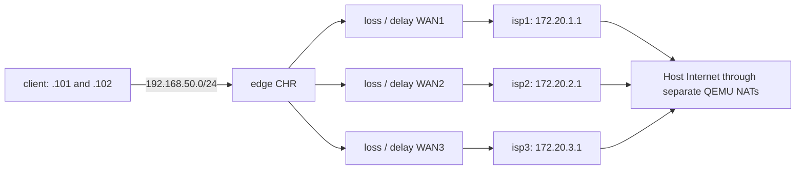

# CHR lab

[Русский](LAB.md)

This page describes the basic local five-CHR lab, not current remote-test or demo
addresses. See [current status](CURRENT-STATUS.en.md); never start a duplicate lab
on top of an active test.

Example project: `C:\src\mikrotik-sd-wan`. Execution: Ubuntu-24.04 under WSL2,
Python 3.12 and QEMU 8.2. Internet/management use QEMU user networking; virtual
links are loopback-only TCP. Physical adapters, Windows routes/firewall and
existing VMs remain unchanged.

## Local SD-WAN and configurator

The base controller uses the **RouterOS scripting language**; an alternative is
a local Rust scratch container with native fallback. Netwatch, SLA, quorum, states
and switching run on MikroTik. There is no external controller process.

On Windows open **`Configure-SD-WAN.cmd`**. The wizard connects through MikroTik API,
reads interfaces/IPs/routes, asks for external WAN selection/priorities and creates
configuration. It provides SLA/client/timer forms, JSON save, RSC export, plan,
deploy and rollback. Control stays on MikroTik.

- [Static, DHCP-client, PPPoE and LTE lifecycle](DYNAMIC-WAN.en.md).
- [Native LTE through APN: setup and limits](LTE.en.md).
- [Historical LTE and later USB RNDIS acceptance](LTE-VALIDATION.en.md).
- [Dynamic WAN regression](DYNAMIC-WAN-VALIDATION.en.md).
- [Group, VLAN and application policies](POLICIES.en.md).
- [Historical diagnostics/policy acceptance](POLICIES-VALIDATION.en.md).
- [GUI: WAN state, selection reasons and events](DIAGNOSTICS.en.md).
- [GUI: connect → select WANs → configure](CONFIGURATOR-WIZARD.en.md).
- [GUI and API-deployment tests](WIZARD-VALIDATION.en.md).
- [Marking, WAN symmetry, conntrack](DATAPLANE.en.md).
- [Connection/deployment/GUI results](CONNECTIONS-VALIDATION.en.md).
- [Protected deployment, watchdog, recovery](DEPLOYMENT.en.md).
- [Roadmap](../ROADMAP.en.md).
- [Native SD-WAN results](NATIVE-VALIDATION.en.md).
- [Native controller files and configurator instructions](NATIVE-CONTROLLER.en.md).
- Initial configuration: `config/sdwan.json`; RouterOS source: `native/`.
- `python3 sdwan.py status` reads router state; `python3 sdwan.py events` reads decisions.
- `python3 tests/native_acceptance.py` runs native SD-WAN fault tests.

## Start from PowerShell

```powershell
cd C:\src\mikrotik-sd-wan
powershell -NoProfile -ExecutionPolicy Bypass -File .\Start-Lab.ps1 up
powershell -NoProfile -ExecutionPolicy Bypass -File .\Start-Lab.ps1 status
powershell -NoProfile -ExecutionPolicy Bypass -File .\Start-Lab.ps1 verify
```

From WSL:

```bash
cd /path/to/mikrotik-sd-wan
python3 lab.py up
python3 lab.py verify
python3 lab.py down
```

`up` retains existing disks/configuration. There is no automatic VM deletion/reset.
`down` requests a normal RouterOS shutdown. Images/passwords persist. Use API/SSH
to change an existing CHR's base configuration; repeating `up` does not reapply it.

## Connections

| Node | WebFig / REST, localhost | SSH, localhost | WinBox, localhost | RAM |
|---|---|---|---|---|
| edge | 18080 | 12222 | 18291 | 1024 MiB |
| isp1 | 18081 | 12223 | 18292 | 512 MiB |
| isp2 | 18082 | 12224 | 18293 | 512 MiB |
| isp3 | 18083 | 12225 | 18294 | 512 MiB |
| client | 18090 | 12230 | 18301 | 512 MiB |

Edge WebFig: <http://localhost:18080>. WinBox: `127.0.0.1:18291`.
SSH: `ssh -p 12222 admin@localhost`. Windows WSL localhost forwarding must be
on, normally the default.

Edge native RouterOS API: **`api://127.0.0.1:18728`**. The GUI Lab button fills this
address and lab credentials. For new VMs, `lab.py` creates API forwards at
18728 + node index; adding a forward for an existing VM does not itself enable
the RouterOS API service.

User `admin`, separate random passwords in private `runtime/credentials.json`.
They are not printed in reports and are Git-excluded. NTFS access depends on
Windows ACLs, not only `chmod`. QEMU consoles (25100 + node index), QMP
(24100 + node index) and emulator management (24099) bind only 127.0.0.1; this NTFS
does not support Unix sockets. HTTP REST is for loopback lab testing; real devices
need certificate-checked HTTPS and a separate least-privilege account.

## Topology



On edge: `ether1` management without default, `ether2/3/4` WAN1/2/3, `ether5` LAN
`192.168.50.1/24`; WAN addresses `172.20.N.2/30`. ISP `ether1` is uplink/management,
`ether2` faces edge. Both edge and ISPs do NAT. Client `ether1` is management without
default; `ether2` is LAN. Addresses .101/.102 belong to one test CHR: two policy
routing sources, not independent operating systems. Linux clients can be added later.

Each ISP has individual probe target `198.18.N.1` and shared `198.19.0.1`. These are
lab addresses; the common target checks every WAN without external ICMP dependency.
Each `probe-wanN` default is pinned to that WAN and cannot fail over. DNS path is
client → edge → ISP → QEMU DNS. Client DNS is allowed from LAN only; ISP DNS from
edge only. SLA DNS probes use an explicit WAN-pinned server; DNS response-content
validation remains planned.

## Base routing

- General WAN1 → WAN2 → WAN3, distances 1/2/3.
- `.102` uses `prefer-wan2`: WAN2 → WAN1 → WAN3; `.101` uses general order.
- `check-gateway=ping` checks the gateway; physical link-down disables the route immediately.
- Separate management interfaces remain reachable with every WAN down. Base input
  firewall blocks management from WAN/LAN; FastTrack is disabled.

This is the saved lab baseline for rollback. Native SD-WAN disables its defaults
and a local RouterOS script decides from `config/sdwan.json`. Client .102 uses voice
SLA and its own table; strict .103 is defined. No external management service is
needed for control.

## Failure and degradation

Run in WSL from the project directory, or through `Start-Lab.ps1` with the same arguments:

```bash
# WAN1 physical failure: RouterOS sees link-down
python3 lab.py link wan1 down
python3 lab.py link wan1 up

# Silent frame loss; link remains up
python3 lab.py fault wan1 --blackhole on
python3 lab.py fault wan1 --blackhole off

# 3% frame loss, delay 80 ms +/- 15 ms IN EACH direction
python3 lab.py fault wan2 --loss 3 --delay 80 --jitter 15

# Per-direction rate limit in kbit/s
python3 lab.py fault wan3 --rate 512

# Restore all links and clear emulator impairments
python3 lab.py heal

# Emulator state and counters
python3 lab.py status
```

`fault` values persist until another command or emulator restart. `--delay` applies
each direction, roughly doubling RTT; `--jitter` is uniform one-way delay variation
with packet ordering retained. `--loss` affects Ethernet frames including ARP.
Queues are bounded at 4096 frames per direction; overflow drops frames. `--rate 0`
removes the cap. CHR Free also limits interface transmit to 1 Mbit/s.

To fail beyond a responding ISP gateway (edge can still ping 172.20.2.1):

```bash
python3 lab.py api isp2 ip/firewall/filter --method PUT --data '{"chain":"forward","action":"drop","place-before":"0","comment":"test-upstream-outage"}'
python3 lab.py api isp2 ip/firewall/filter
# Delete the added rule using its returned .id (example *A):
python3 lab.py api isp2 'ip/firewall/filter/*A' --method DELETE
```

A forward-filter rule is the preferred upstream-outage fixture: gateway ping and
management remain while Internet transit stops. `heal` clears emulator impairments
and QMP link-down only; it does not remove manually added RouterOS rules.

## Checks and artifacts

```bash
python3 lab.py verify
python3 tests/native_acceptance.py
# Old baseline tests: only after python3 sdwan.py rollback
# python3 tests/acceptance.py
# Optional actual Internet check from both clients:
python3 tests/internet.py
python3 lab.py api edge system/resource
python3 lab.py api edge ip/route
python3 lab.py api client ping --data '{"address":"198.19.0.1","src-address":"192.168.50.102","count":"5"}'
python3 lab.py export edge
```

`verify` distinguishes baseline/native SD-WAN automatically and checks exact versions
on five CHRs, three individual probe targets, LAN/shared target from both client
addresses and active route priorities. Output: `runtime/verification.json`.
Fault/Internet checks are separate; `verify` does not establish full SD-WAN readiness.

`tests/acceptance.py` exercises baseline routing only after rollback: temporarily
disables WANs, confirms .101/.102 exits with ISP counters, tests new-flow recovery
after link-down/blackhole, added latency and management with all WANs failed.
`finally` restores links. Lab only; output `runtime/acceptance.json`. It resets
emulator impairments. After abnormal termination run `python3 lab.py heal`.

Actual Internet is checked separately with TCP/HTTP/HTTPS. ICMP through QEMU user
networking depends on Linux ping-socket permission and is not an actual independent
provider. In the observed WSL, default `ping_group_range` denied the WSL user;
sysctl was unchanged. Lab ICMP targets therefore live on ISPs. The current controller
additionally uses configured TCP/DNS/HTTPS probes for resource checks.

`tests/internet.py` checks DNS and certificate-verified `https://mikrotik.com/` from
each client source, saving `runtime/internet.json`. It is manual, not periodic
manufacturer-site monitoring. Choose agreed targets for your own SLA. Initial
RouterOS HTTPS to `example.com` failed with `no trusted CA certificate found`,
while `mikrotik.com` passed. Check each target's CA-chain support rather than
disabling verification.

`routeros/*.rsc` are readable base configurations generated by `prepare/up` for
clean lab CHRs; they contain no passwords. Original results:
[VALIDATION.md](VALIDATION.en.md).

`images/manifest.json` binds ZIP/RAW URL and SHA256. Provenance checks are official
HTTPS and ZIP CRC; locally computed SHA256 is not a manufacturer signature.
Original RAW stays read-only; each CHR has a qcow2 overlay expanded to 512 MiB.
Move the whole folder: overlays reference the base RAW by absolute path.

There are no pip dependencies. VMs use one vCPU each, total RAM 3 GiB. KVM is
selected with access to `/dev/kvm` or `kvm` membership; otherwise slower TCG.
In this example add `linuxuser` to Ubuntu-24.04's normal `kvm` group. Before the
current shell refreshes group membership, the script uses `sg kvm` for QEMU.
A temporary device ACL proved unstable in this WSL; permanent access uses the group.
From PowerShell, replace `linuxuser` with your WSL username:

```powershell
wsl.exe -d Ubuntu-24.04 -u root -- usermod -aG kvm linuxuser
```

To undo after stopping the lab/restarting the shell:
`wsl.exe -d Ubuntu-24.04 -u root -- gpasswd -d linuxuser kvm`. Other system settings
were unchanged.

If API/consoles do not respond, inspect `runtime/*.qemu.log`, `runtime/proxy.log` and
`python3 lab.py status`. Never delete running VM disks. Bootstrap records its last
completed command in `runtime/*.bootstrap.json` and can resume interrupted initial
setup. Do not reorder commands during unfinished bootstrap. Do not manage VMs
simultaneously from multiple shells.

## Vendor documentation

- [MikroTik CHR requirements/licensing](https://help.mikrotik.com/docs/spaces/ROS/pages/18350234/Cloud+Hosted+Router+CHR)
- [RouterOS REST API](https://help.mikrotik.com/docs/spaces/ROS/pages/47579162/REST+API)
- [Policy Routing](https://help.mikrotik.com/docs/spaces/ROS/pages/59965508/Policy+Routing)
- [Netwatch](https://manual.mikrotik.com/docs/diagnostics-monitoring-and-troubleshooting/netwatch/):
  current documentation is newer than 7.24.5; verify parameters on the lab.
- [QEMU networking](https://www.qemu.org/docs/master/system/devices/net.html)

CHR Free provides RouterOS features with 1 Mbit/s interface egress limits.
Throughput testing needs trial/paid licensing; purchase/activation is outside base
lab preparation.

- [Local Rust controller in a minimal scratch container](CONTAINER.en.md).
