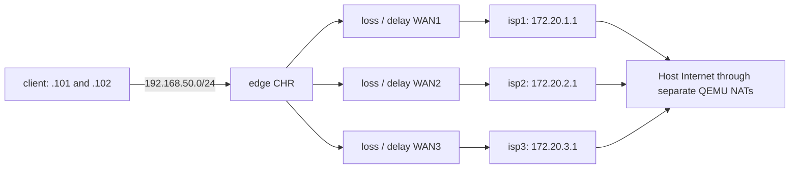

# Лаборатория CHR

[English](LAB.en.md)

Ниже базовый локальный стенд из пяти CHR, а не адреса текущих удалённых тестов или демо. Текущий статус — [CURRENT-STATUS.md](CURRENT-STATUS.md); не запускайте второй стенд поверх действующего теста.


Проект: `C:\src\mikrotik-sd-wan`. Исполнение: Ubuntu-24.04 в WSL2, Python 3.12 и QEMU 8.2. Интернет и управление — QEMU user networking, виртуальные линии — TCP только на loopback. Физические адаптеры, маршруты Windows, firewall Windows и существующие VM не меняются.

## Локальный SD-WAN и конфигуратор

Базовый контроллер реализован **на скриптовом языке RouterOS**; альтернативный режим — локальный Rust scratch-контейнер с нативным резервом. Netwatch, SLA, кворум, состояния и переключение исполняются на самом MikroTik. Внешнего процесса-контроллера нет.

Для графической настройки в Windows откройте **`Configure-SD-WAN.cmd`**. Мастер подключается к API MikroTik, получает реальные интерфейсы, IP и маршруты, предлагает выбрать внешние WAN и их приоритеты, затем создаёт конфигурацию. Дальше доступны формы SLA, клиентов и таймеров, сохранение JSON, экспорт `.rsc`, план, установка и откат. Контроллер работает на самом MikroTik.

- [Static, DHCP-client, PPPoE и LTE: параметры и жизненный цикл](DYNAMIC-WAN.md).
- [Native LTE через APN: настройка и ограничения](LTE.md).
- [Историческая приёмка LTE и последующие USB RNDIS-проверки](LTE-VALIDATION.md).
- [Проверки dynamic WAN и регрессия](DYNAMIC-WAN-VALIDATION.md).
- [Политики групп, VLAN и приложений](POLICIES.md).
- [Историческая приёмка диагностики и политик](POLICIES-VALIDATION.md).
- [GUI: состояние WAN, причины выбора и история](DIAGNOSTICS.md).
- [GUI: подключение → выбор WAN → конфигурация](CONFIGURATOR-WIZARD.md).
- [Проверки GUI и установки через API](WIZARD-VALIDATION.md).
- [Маркировка, симметрия WAN и conntrack](DATAPLANE.md).
- [Итоги проверки соединений, установки и GUI](CONNECTIONS-VALIDATION.md).
- [Защищённая установка, watchdog и восстановление](DEPLOYMENT.md).
- [План развития](../ROADMAP.md).
- [Результаты проверок нативного SD-WAN](NATIVE-VALIDATION.md).
- [Нативный контроллер, файлы и инструкция конфигуратора](NATIVE-CONTROLLER.md).
- Исходная конфигурация: `config/sdwan.json`; код RouterOS: `native/`.
- `python3 sdwan.py status` — состояние с самого роутера; `python3 sdwan.py events` — журнал решений.
- `python3 tests/native_acceptance.py` — аварийные проверки нативного SD-WAN.

## Запуск из PowerShell

```powershell
cd C:\src\mikrotik-sd-wan
powershell -NoProfile -ExecutionPolicy Bypass -File .\Start-Lab.ps1 up
powershell -NoProfile -ExecutionPolicy Bypass -File .\Start-Lab.ps1 status
powershell -NoProfile -ExecutionPolicy Bypass -File .\Start-Lab.ps1 verify
```

Из WSL:

```bash
cd /path/to/mikrotik-sd-wan
python3 lab.py up
python3 lab.py verify
python3 lab.py down
```

`up` сохраняет существующие диски и конфигурацию. В проекте нет автоматического удаления или сброса VM. `down` запрашивает штатное завершение RouterOS. Образы и пароли сохраняются. Для изменения базовой конфигурации уже созданного CHR используйте API/SSH; повторный `up` не применяет конфигурацию заново.

## Подключение

| Узел | WebFig / REST, localhost | SSH, localhost | WinBox, localhost | RAM |
|---|---|---|---|---|
| edge | 18080 | 12222 | 18291 | 1024 MiB |
| isp1 | 18081 | 12223 | 18292 | 512 MiB |
| isp2 | 18082 | 12224 | 18293 | 512 MiB |
| isp3 | 18083 | 12225 | 18294 | 512 MiB |
| client | 18090 | 12230 | 18301 | 512 MiB |

WebFig основного роутера: <http://localhost:18080>. WinBox: `127.0.0.1:18291`. SSH: `ssh -p 12222 admin@localhost`. В Windows localhost forwarding WSL должен быть включён (обычное значение по умолчанию).

Нативный RouterOS API основного роутера: **`api://127.0.0.1:18728`**. Кнопка «Лаборатория» в GUI подставляет этот адрес и учётные данные стенда. На новых VM `lab.py` также создаёт API-проброс 18728 + номер узла; для уже созданных VM добавление проброса само по себе не включает API-сервис.

Пользователь `admin`, отдельные случайные пароли — `runtime/credentials.json`. Они не выводятся в отчётах и исключены из Git. Каталог находится на NTFS: доступ определяется ACL Windows, не только `chmod`. Консоли QEMU (25100 + номер узла), QMP (24100 + номер узла) и управление эмулятором (24099) доступны только на `127.0.0.1`; Unix-сокеты на этом NTFS не поддерживаются. HTTP REST допускается здесь для тестов на loopback; для настоящих устройств нужен HTTPS с проверкой сертификата и отдельная учётная запись с минимальными правами.

## Топология



На edge `ether1` — управление (без default route), `ether2/3/4` — WAN1/2/3, `ether5` — LAN `192.168.50.1/24`. WAN адреса edge: `172.20.N.2/30`. У ISP `ether1` — uplink и управление, `ether2` — к edge. NAT есть на edge и на ISP. На client `ether1` — управление без default route, `ether2` — LAN. Адреса `.101` и `.102` принадлежат одному тестовому CHR: это два источника для тестов policy routing, не две независимые ОС. Позднее можно подключить Linux-клиентов.

На каждом ISP есть индивидуальная контрольная цель `198.18.N.1` и общая цель `198.19.0.1`. Это лабораторные адреса; общая цель позволяет проверять доступность через любой WAN без зависимости от внешнего ICMP. В таблицах `probe-wanN` default route строго задан через соответствующий WAN и не переключается на другой канал. DNS client → edge → ISP → встроенный DNS QEMU. DNS от клиентов разрешён только с LAN, на ISP — только со стороны edge. Для SLA-проб DNS задаётся конкретный сервер и закрепляется WAN; проверка корректности содержимого DNS остаётся в плане.

## Уже настроенная базовая маршрутизация

- Общая очередь WAN1 → WAN2 → WAN3, distance 1/2/3.
- Для `.102` отдельная таблица `prefer-wan2`: WAN2 → WAN1 → WAN3. `.101` следует общей очереди.
- RouterOS `check-gateway=ping` проверяет шлюз, а физический link-down отключает маршрут сразу.
- Управление доступно через отдельные интерфейсы даже при отключении всех WAN. Сервисы управления со стороны WAN и LAN закрыты input firewall. FastTrack не включён.

Это сохранённая исходная конфигурация стенда для отката. При установленном нативном SD-WAN её default routes отключены, а решения принимает локальный RouterOS script по `config/sdwan.json`. Клиент `.102` использует voice SLA и собственную таблицу; предусмотрена строгая политика для `.103`. Установка контроллера не требует внешнего сервиса управления.

## Аварии и деградация

Команды выполняются в WSL из каталога проекта, либо через `Start-Lab.ps1` с такими же аргументами:

```bash
# WAN1 physical failure: RouterOS sees link-down
python3 lab.py link wan1 down
python3 lab.py link wan1 up

# Silent frame loss; link remains up
python3 lab.py fault wan1 --blackhole on
python3 lab.py fault wan1 --blackhole off

# 3% frame loss, delay 80 ms +/- 15 ms IN EACH direction
python3 lab.py fault wan2 --loss 3 --delay 80 --jitter 15

# Per-direction rate limit in kbit/s
python3 lab.py fault wan3 --rate 512

# Restore all links and clear emulator impairments
python3 lab.py heal

# Emulator state and counters
python3 lab.py status
```

Значения `fault` сохраняются до следующей команды или перезапуска процесса эмулятора. `--delay` добавляется в каждую сторону, поэтому RTT растёт приблизительно на удвоенное значение; `--jitter` — равномерный разброс односторонней задержки, с сохранением порядка пакетов. `--loss` применяется к Ethernet-кадрам, включая ARP. Эмулятор имеет ограниченные очереди (4096 кадров на направление), при переполнении кадры теряются. `--rate 0` отменяет лимит. CHR Free дополнительно ограничивает передачу до 1 Мбит/с на интерфейс.

Для аварии за доступным шлюзом ISP (edge продолжает пинговать 172.20.2.1):

```bash
python3 lab.py api isp2 ip/firewall/filter --method PUT --data '{"chain":"forward","action":"drop","place-before":"0","comment":"test-upstream-outage"}'
python3 lab.py api isp2 ip/firewall/filter
# Delete the added rule using its returned .id (example *A):
python3 lab.py api isp2 'ip/firewall/filter/*A' --method DELETE
```

Предпочтительный тест upstream-outage — правило filter: управление и ping шлюза сохраняются, транзит в интернет прекращается. `heal` убирает только воздействия эмулятора и QMP link-down, не меняет добавленные вручную правила RouterOS.

## Проверка и артефакты

```bash
python3 lab.py verify
python3 tests/native_acceptance.py
# Old baseline tests: only after python3 sdwan.py rollback
# python3 tests/acceptance.py
# Optional actual Internet check from both clients:
python3 tests/internet.py
python3 lab.py api edge system/resource
python3 lab.py api edge ip/route
python3 lab.py api client ping --data '{"address":"198.19.0.1","src-address":"192.168.50.102","count":"5"}'
python3 lab.py export edge
```

`verify` автоматически различает baseline и установленный нативный SD-WAN. Проверяет точную версию всех пяти CHR, три индивидуальные контрольные цели, доступ к LAN и общую цель с обоих клиентских адресов, активные приоритетные маршруты. Результат: `runtime/verification.json`. Проверки отказов и внешнего интернета документируются отдельно; `verify` не доказывает готовность полноценного SD-WAN.

`tests/acceptance.py` относится к исходной маршрутизации, запускается только после rollback и временно отключает WAN, проверяет фактический выход `.101` и `.102` счётчиками на ISP, восстановление новых потоков после link-down и blackhole, добавленную задержку и доступность управления при отказе всех WAN. В `finally` восстанавливает каналы. Запускайте только на стенде; результат — `runtime/acceptance.json`. Сценарий сбрасывает текущие воздействия эмулятора. При аварийном завершении процесса выполните `python3 lab.py heal`.

Внешний интернет проверяется TCP/HTTP/HTTPS отдельно: ICMP через QEMU user networking зависит от разрешения ping sockets в Linux и не эквивалентен реальному каналу. В этой WSL `ping_group_range` по умолчанию не разрешает ICMP sockets пользователю WSL; системный sysctl не менялся. Поэтому лабораторные ICMP-цели находятся на самих ISP, а текущий контроллер дополнительно использует настроенные TCP/DNS/HTTPS-пробы для проверки ресурсов.

`tests/internet.py` использует DNS и HTTPS `https://mikrotik.com/` с проверкой сертификата и source IP каждого клиента, сохраняет `runtime/internet.json`. Это ручной тест, не периодический мониторинг сайта производителя. Для своего SLA выберите собственные согласованные контрольные цели. При первоначальной проверке HTTPS `example.com` не прошёл встроенное хранилище CA RouterOS (`no trusted CA certificate found`), а HTTPS `mikrotik.com` прошёл. Для каждой HTTPS-цели нужно проверять поддержку её цепочки CA, не отключать проверку сертификатов.

`routeros/*.rsc` — читаемые базовые конфигурации всех пяти узлов, генерируются при `prepare/up` и предназначены для чистого лабораторного CHR. Паролей в них нет. Итог первоначальных проверок — [VALIDATION.md](VALIDATION.md).

`images/manifest.json` фиксирует URL и SHA256 исходного ZIP и RAW. Проверка источника: HTTPS официального сервера, ZIP CRC; SHA256 вычислен локально и не является подписью производителя. Оригинальный RAW не используется для записи; у каждого CHR свой qcow2 overlay, увеличенный до 512 MiB. Перемещайте каталог целиком: overlays ссылаются на абсолютный путь базового RAW.

Зависимостей pip нет. Все VM — по одному vCPU, суммарная RAM 3 GiB. KVM выбирается при наличии доступа к `/dev/kvm` либо членства в группе `kvm`, иначе TCG (медленнее). Для этого примера пользователь `linuxuser` добавляется в стандартную группу `kvm` в Ubuntu-24.04. До обновления групп текущей оболочки скрипт использует `sg kvm` для запуска QEMU. При подготовке также проверялся временный ACL устройства; он оказался нестабильным в этой WSL, поэтому постоянный доступ настроен через группу. Для повторения настройки на другой машине из PowerShell замените `linuxuser` именем своего пользователя WSL:

```powershell
wsl.exe -d Ubuntu-24.04 -u root -- usermod -aG kvm linuxuser
```

При необходимости отменить изменение группы: `wsl.exe -d Ubuntu-24.04 -u root -- gpasswd -d linuxuser kvm` (после остановки лаборатории и перезапуска оболочки). Остальные системные настройки не менялись.

Если API или консоли не отвечают, смотрите `runtime/*.qemu.log`, `runtime/proxy.log` и `python3 lab.py status`. Не удаляйте диски работающей лаборатории. Bootstrap сохраняет номер последней выполненной команды в `runtime/*.bootstrap.json` и может продолжить прерванную первичную настройку. Не редактируйте порядок команд во время незавершённого bootstrap. Операции управления VM не следует запускать одновременно из нескольких оболочек.

## Документация производителей

- [MikroTik CHR, требования и лицензирование](https://help.mikrotik.com/docs/spaces/ROS/pages/18350234/Cloud+Hosted+Router+CHR)
- [RouterOS REST API](https://help.mikrotik.com/docs/spaces/ROS/pages/47579162/REST+API)
- [Policy Routing](https://help.mikrotik.com/docs/spaces/ROS/pages/59965508/Policy+Routing)
- [Netwatch](https://manual.mikrotik.com/docs/diagnostics-monitoring-and-troubleshooting/netwatch/) — текущая документация новее 7.24.5, параметры необходимо проверять на стенде.
- [QEMU networking](https://www.qemu.org/docs/master/system/devices/net.html)

Бесплатная лицензия CHR даёт функции RouterOS, но ограничивает исходящую скорость интерфейса 1 Мбит/с. Для измерения пропускной способности понадобится trial или платная лицензия; покупка/активация в подготовку не входит.

- [Локальный Rust-контроллер в минимальном scratch-контейнере](CONTAINER.md).
